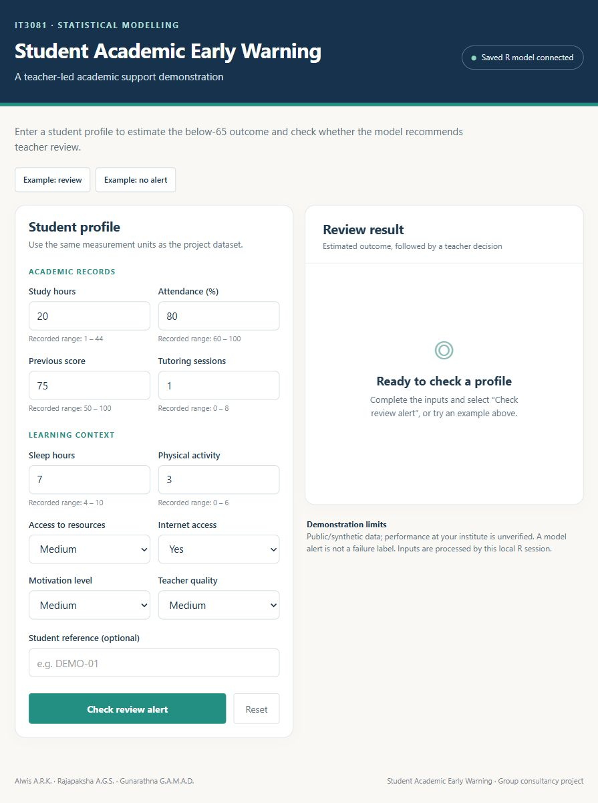
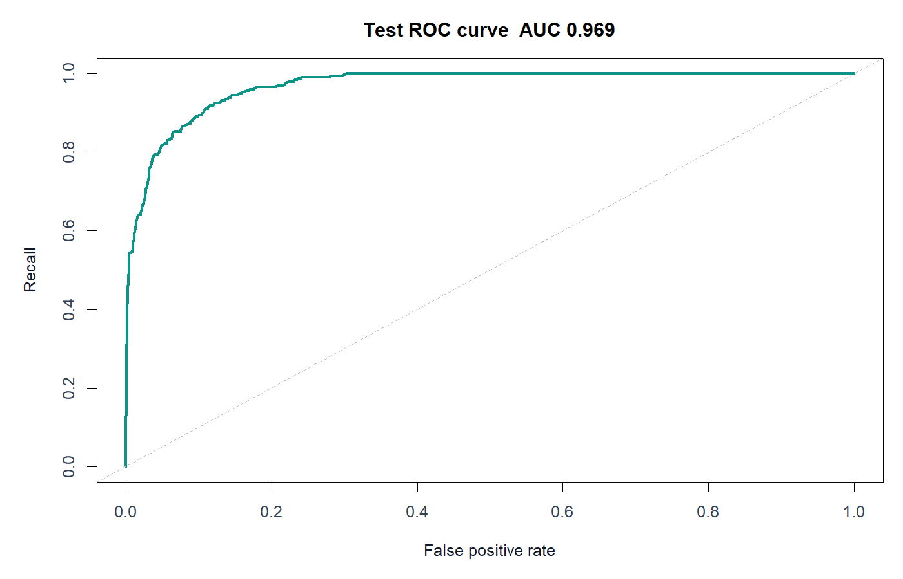

# Student Academic Early Warning System

An academic support prototype built with **R and Shiny**. It estimates the probability of an exam score below an illustrative threshold of 65 and flags profiles for **teacher review**.

The Shiny application loads the actual saved `.rds` model and calls `predict()` in R. Predictions are not hard-coded and the model is not retrained when an input changes.



## Features

- Data auditing, descriptive analysis and hypothesis testing with Holm adjustment.
- Linear and ridge regression comparisons for score prediction.
- A ten-input logistic regression model for the below-65 outcome.
- Training-only preprocessing and stratified train/validation/test partitions.
- Validation-based threshold selection, calibration and bootstrap intervals.
- Subgroup and sensitivity analyses, with limitations reported explicitly.
- A Shiny dashboard with editable inputs, example profiles and review alerts.

## Run the dashboard

Tested with **R 4.6.1** and **Shiny 1.14.0**. Install R and optionally RStudio, then clone the repository:

```sh
git clone https://github.com/RavinduAlwis2004/Student_Academic_Early_Warning_System.git
```

Open `Student_Academic_Early_Warning_System.Rproj` in RStudio and run:

```r
setwd("shiny")
source("run_dashboard.R")
```

On the first run, `setup.R` installs Shiny and its dependencies from CRAN into a project-local library. **Internet is needed for that initial installation.** Afterwards, this local dashboard uses the included model without an internet connection. Open the app in a normal Chrome or Edge browser and keep R running. Use Esc or the RStudio Stop button to end the session.

For a quick demonstration, select **Example: review** (about 71.85%) or **Example: no alert** (about 12.04%). The examples are illustrative profiles from the existing synthetic test data, not additional validation observations. Editing an input hides the previous result until the updated profile is evaluated.

## Prediction workflow

```text
Ten profile inputs
    -> input validation and saved factor levels
    -> predict(saved_logistic_model, type = "response")
    -> estimated below-65 probability
    -> saved threshold comparison
    -> teacher-review alert or no model alert
```

The inputs are study hours, attendance, previous score, tutoring sessions, sleep, physical activity, resource access, internet access, motivation and teacher quality. Input units must match the source dataset. Final exam score is never an input to the risk model. Direct income, gender and disability inputs are excluded from the selected model; this does not establish fairness.

## Held-out evaluation

The clean dataset contains **6,606 records**, split into **3,963 training**, **1,320 validation** and **1,323 test** records. Models and the alert policy were selected on validation data, not the test set.

| Selected risk-model metric | Test result |
|---|---:|
| ROC AUC | 0.9686 |
| Average precision | 0.9039 |
| Recall | 85.91% |
| Precision | 76.22% |
| Brier score | 0.0579 |
| Alert threshold | 0.360444876165715 |
| Teacher-review alerts | 328 |

| Actual outcome | No alert | Review alert |
|---|---:|---:|
| Score at least 65 | 954 | 78 |
| Score below 65 | 41 | 250 |

The threshold is the largest validation probability meeting an illustrative **recall target of at least 85%**. Compared with 0.5, it identifies 19 additional below-65 test outcomes while adding 33 false alerts and 52 reviews. This is a capacity trade-off, not a universally appropriate policy.

The selected full linear score model achieved **test MAE 0.457**, **RMSE 1.816** and **R² 0.753**. Residual nonnormality remains, so normal-error prediction intervals are not established.

### Uncertainty and calibration

The selected classifier's test calibration intercept is approximately −0.031 and its slope 1.073. Percentile intervals from 600 bootstrap samples of fixed test predictions are:

| Metric | 95% bootstrap interval |
|---|---:|
| AUC | 0.9595–0.9758 |
| Recall | 81.76%–89.80% |
| Precision | 71.47%–80.83% |

These intervals do not include model-selection or distribution-shift uncertainty. R scoring was checked against all 1,323 original test predictions, and Shiny server/live-connection tests exercised both alert states and changed-input invalidation.



## Reproduce the analysis

1. Obtain the original CSV using the instructions in [data/README.md](data/README.md).
2. Place it at `data/StudentPerformanceFactors.csv`.
3. Start from the repository root in RStudio and run:

```r
source("analysis.R")
```

The analysis requires **base R only**. It writes additional tables, figures and the saved model bundle under `results/`; a curated subset of evaluation summaries is already included. The dataset and generated local artifacts are ignored by Git.

To replace the dashboard's fitted model after reproducing this exact workflow:

```r
file.copy(
  "results/student_early_warning_prototype.rds",
  "shiny/models/student_early_warning_prototype.rds",
  overwrite = TRUE
)
```

Restart the app after changing its model. Run the scoring checks from the repository root:

```r
source("tests/test_model_service.R")
```

## Repository structure

```text
analysis.R                         Complete statistical workflow
Student_Academic_Early_Warning_System.Rproj
shiny/
  app.R                            Shiny inputs, events and results
  model_service.R                  Saved-model loading and prediction
  demo_profiles.R                  Example input profiles
  setup.R                          Shiny dependency installation
  run_dashboard.R                  Local app launcher
  models/                          Saved fitted model bundle
  www/dashboard.css                Dashboard styling
data/README.md                     Dataset source and placement
results/                           Curated evaluation summaries
docs/images/                       Dashboard preview and result figures
tests/test_model_service.R         Model integration checks
```

## Interpretation and limits

- The [source dataset](https://www.kaggle.com/datasets/lainguyn123/student-performance-factors) is public; a [published study](https://doi.org/10.3390/info16090763) describes the matching named dataset as synthetic. Local operational accuracy is unverified.
- **Below 65 is an illustrative review outcome**, not a verified failure mark or proof that additional classes are needed.
- No model alert is not a guarantee that a student has no academic concern. Teachers retain the final support decision.
- Measurement timing is unverified. Actual early warning requires inputs collected before the predicted assessment.
- Associations are not causal effects. Changing an input does not estimate the benefit of an intervention.
- Low-income test recall was lower than that of other income groups. Removing direct sensitive inputs does not establish fairness.
- Future institutional data, capacity assessment and a separate evaluation of support effectiveness are needed before deployment.

## Project credits

Developed as a third-year Statistical Modelling group project by **Alwis A.R.K., Rajapaksha A.G.S. and Gunarathna G.A.M.A.D.** Ravindu Alwis led the implementation and statistical workflow.

The original data provider and research sources retain credit for their work. Private consultation forms and local R history are not part of this public repository.
